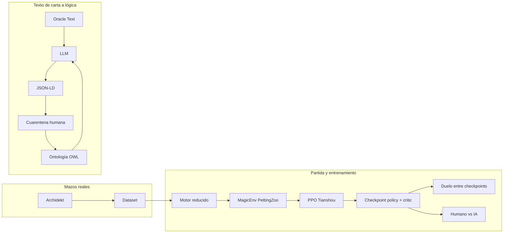
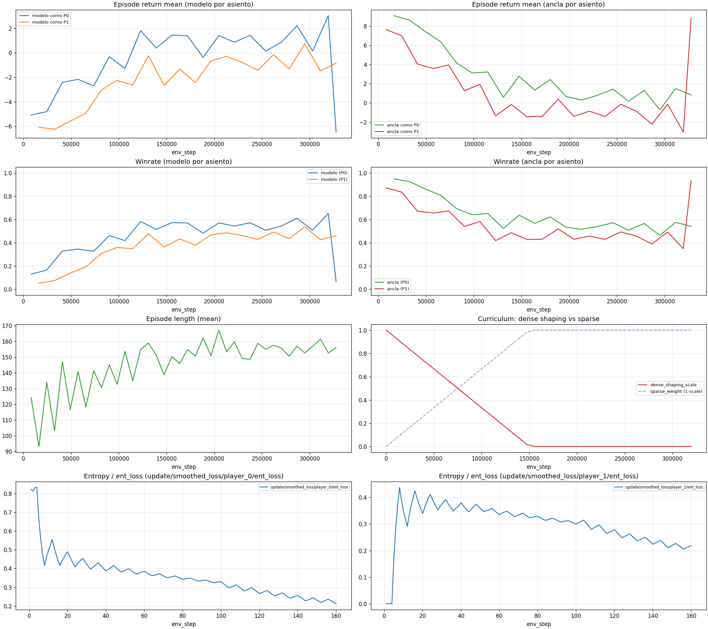

# Motor reducido de Magic para aprendizaje por refuerzo [En Desarrollo]


Prototipo de RL: un motor simplificado de *Magic: The Gathering* expuesto como entorno multiagente, con entrenamiento PPO, evaluación reproducible y un pipeline aparte que traduce el texto de las cartas a una representación formal (OWL + JSON-LD).

El reglamento completo del juego es demasiado grande para usarlo como primer banco de pruebas. Si un agente no aprende, no se puede saber si falla la red o el motor. Este repositorio fija primero un subconjunto jugable —robar, jugar tierras, invocar criaturas y resolver combate— y construye encima el ciclo completo de experimentación: entrenar, registrar, comparar políticas y revisar el comportamiento a mano.

---

## Qué incluye

Dos líneas de trabajo, independientes entre sí.

**Entorno y agentes.** Partidas 1v1 sobre el motor reducido, observación numérica fija, enmascaramiento de acciones ilegales y políticas entrenadas con PPO (Tianshou). Hay self-play, reanudación desde un checkpoint, entrenamiento contra un oponente congelado y tres señales de recompensa: densa, escasa y curriculum (el shaping denso se apaga de forma lineal).

**Representación de cartas.** Un CLI traduce Oracle Text a JSON-LD. La ontología OWL es el vocabulario permitido. Si el modelo necesita un concepto que no existe, la carta entra en cuarentena y una revisión humana acepta, rechaza o corrige cada propuesta antes de escribirla en el OWL y en el JSON operativo.

Los mazos públicos de Archidekt pueden alimentar el motor de entrenamiento reducido (`MagicEnv`, 124/50). En paralelo, el adaptador de `reglas/` alimenta dos entornos PettingZoo nuevos: un puente 124/50 compatible con los checkpoints viejos y un starter con observación por fichas que ya no carga esos `.pth`.

La primera base de cartas traducida es el Starter Kit de Bloomburrow: Hare Raising y Otter Limits, sesenta cartas cada uno. Las cantidades siguen en `mazos/bloomburrow_starter.json`. El Oracle Text oficial, tomado de Scryfall, está en `mazos/bloomburrow_oracle.json`. Cada carta en JSON-LD está en `mazos/bloomburrow_jsonld/`, y el índice con las cantidades en `mazos/bloomburrow_jsonld/_indice.json`.

---

## Arquitectura



| Pieza | Papel |
| --- | --- |
| `motor_prueba/motor.py` | Turnos, fases, acciones legales, combate y recompensa (línea base 124/50) |
| `motor_prueba/env_magic.py` | Entorno AEC de PettingZoo. Observación de 124 valores y máscara sobre 50 acciones |
| `motor_prueba/env_adaptador.py` | Puente PettingZoo 124/50 sobre `reglas.Adaptador` (Forest+Oso) |
| `motor_prueba/env_starter.py` | Starter Hare Raising vs Otter Limits; observación `ficha_v1` y `Discrete(MAX_ACCIONES_STARTER)` |
| `motor_prueba/ficha_rl.py` | Codifica definición JSON-LD + copia en ficha fija; arma el vector plano del starter |
| `motor_prueba/red_fichas.py` | Torso compartido, actor de 16 logits y crítico sobre `ficha_v1` |
| `motor_prueba/train.py` | Entrenamiento PPO sobre `MagicEnv`, logs y checkpoints |
| `motor_prueba/train_adaptador.py` | PPO self-play sobre puente o starter (`--env puente|starter`) |
| `motor_prueba/match_starter.py` | Duelos del starter: política contra política o contra aleatorio, con cambio de asiento |
| `motor_prueba/train_modes.py` | Curriculum, warm-start y oponente congelado |
| `motor_prueba/deck_loader.py` | Mazos de Archidekt reducidos a tierras y criaturas |
| `traduccion/agente_mtg_cli.py` | Oracle Text a JSON-LD, cuarentena y validación |
| `reglas/` | Compila ese JSON-LD y ejecuta primitivas, estáticas, disparos y costes |
| `reglas/adaptador.py` | Partida reducida (tierras, hechizos, activadas, combate) encima de `Partida` |
| `traduccion/ontology_store.py` | OWL como fuente de verdad y exportación a JSON |
| `IA_OWL/OWL_tfg.rdf` | Ontología editable en Protégé |
| `IA_JSON/ontologia_motor.json` | Diccionario operativo que consume el prompt y el validador |

La red es un backbone de dos capas de 128 unidades. El actor sale a 50 acciones discretas y el crítico a un escalar. Una política propia multiplica las probabilidades del actor por la máscara y renormaliza, de modo que una jugada ilegal tiene probabilidad cero.

---

## Decisiones que sostienen el prototipo

**Máscara de acciones de verdad.** El entorno devuelve `observation` y `action_mask`. La máscara llega hasta el muestreo de la política, no se queda en un filtro posterior. El log cuenta además los intentos inválidos, para poder comparar un entreno con máscara y otro sin ella (`--disable-mask`).

**Recompensa como variable experimental.** La señal terminal es siempre +10 / −10. El modo denso suma premios pequeños por jugar una carta, declarar atacantes o bloqueadores y por el daño infligido. El modo escaso deja solo el resultado final. El curriculum empieza en denso y lleva la escala de esos premios a cero. Así se puede estudiar el shaping sin cambiar el código entre runs.

**Métrica que no miente en un juego de suma cero.** La media de (+10, −10) es 0 aunque haya un ganador claro. En modo escaso, y cuando el curriculum ya está cerca de escaso, el reward de test usa la media del valor absoluto por episodio.

**Trazabilidad ligera.** Cada run escribe un JSONL con pasos, fin de episodio y metadatos de época, escalares en TensorBoard y una línea en `logs/runs_manifest.jsonl` con hiperparámetros, semilla, dataset y rutas. El checkpoint guarda actor y crítico (`magic_policy_critic_v1`) y no pisa un fichero ya existente.

**Self-play y una línea base fija.** Warm-start continúa una política en self-play. El modo ancla enfrenta al aprendiz con una copia congelada (`FrozenPPO`, sin gradiente) y puede intercambiar asientos para no confundir “mejor política” con “ventaja de ir primero”.

**Traducción con tres contratos alineados.** El OWL dice qué conceptos existen, el prompt obliga al modelo a usarlos y un validador Python comprueba el JSON después de la llamada. Las condiciones y las cantidades son composición de primitivas (`COMPARISON`, conteos, referencias a atributos), para no inventar una constante nueva por cada carta.

**Un solo nombre por concepto.** Cada clase de la ontología se escribe en PascalCase y ese identificador se copia tal cual en el prompt, el JSON y el validador: `DrawCard`, `EnterTheBattlefield`, `MoveZone`. No se usan mayúsculas sostenidas ni guiones bajos. Las palabras de sintaxis del motor (`NONE`, `COUNT`, `SOURCE`, los operadores y los colores) no son clases. Una propuesta de cuarentena trae `category` con el nombre exacto de la clase raíz (`Effect`, `TriggerEvent`, `KeywordAbility`, `Counter`, `Zone`, `PhaseAndStep`, `Ability`, `Cost`, `CardType`, `CardAttribute`, `CardSupertype`, `Status`, `GameEntity`) y `proposed_constant` en PascalCase, nombrando un solo concepto reutilizable. `Exile` es la zona; exiliar se expresa con `MoveZone`. Lo opcional no es una keyword. Los efectos que describían una carta concreta han salido del vocabulario.

---

## Traducción del starter

`mazos/build_bloomburrow_jsonld.py` lee el Oracle Text y vuelve a escribir las 39 cartas distintas. Las clases que faltaban se aceptan con `ontology_store`, el mismo camino que una propuesta marcada con Y en el CLI: subclase OWL, comentario en español y entrada en `IA_JSON/ontologia_motor.json`.

Cada efecto es una primitiva. Un +2/+1 son `ModifyPower` y `ModifyToughness`. Doblar los contadores +1/+1 es `AddCounter` cuyo `amount` es el número de contadores de esa clase que el objeto ya tiene. Rabid Bite es un `DealDamage`: `damage_source` es la criatura propia y `amount` es su poder. Ganar vida, añadir maná, scry, mirar, revelar hasta una tierra, copiar un hechizo o crear una ficha copia son clases propias porque no salen de combinar las que ya había.

Prowess no lleva parámetros: va en `keywords` y su comentario en el OWL dice cómo se ejecuta. Equip, Enchant y Offspring sí llevan coste u objetivo. Están en `keywords` y, además, en la ability que los ejecuta, marcada con `implements_keyword`. El motor usa esa ability y no vuelve a inyectar el recordatorio.

El prompt del agente recoge las convenciones que estas cartas necesitan:

- `restrictions.subtypes` filtra Rabbit u Otter. El subtipo no es una clase.
- `trigger.subject` elige el objeto del evento y ese objeto es `EVENT_OBJECT`. El trigger se dispara una vez por objeto que cumple el filtro.
- `condition_groups` con operador `OR` es una disyunción de filtros. Alania dispara una sola vez aunque el hechizo sea a la vez el primer instantáneo y el primer Otter.
- `PREVIOUS_TARGET` es el resultado del efecto anterior. `ATTACHED` es la criatura encantada o equipada.
- `MoveZone` desde la biblioteca, sin objetivo, toma el tope. Si otra carta entra girada, después va un `Tap`. `EnterTapped` queda para el permanente que entra girado él mismo.
- Las condiciones se evalúan al resolver el efecto, cuando los efectos anteriores de la misma habilidad ya se han aplicado. Finneas mira el poder con los contadores ya puestos. Rabid Gnaw inflige daño con el +1/+0 ya aplicado.

En Fecund Greenshell, «resistencia mayor que su poder» se aplica a la criatura que entra, incluida la fuente. Con el 4/6 impreso, entra y el disparo se cumple.

`reglas/` es el intérprete de ese JSON-LD. `compilar` deja una `Definicion` inmutable; cada copia en la partida es un `Objeto` con id y generación. No se genera una función por carta.

Las habilidades estáticas no se escriben sobre la carta. `poder`, `resistencia` y `tiene_keyword` las vuelven a leer en ese momento: primero la habilidad que define la fuerza (`SetPowerToughness`), después los bonos (`ModifyPower`, `ModifyToughness`) y al final los contadores. Si el cálculo vuelve a entrar en el mismo objeto, usa la fuerza impresa y termina. Así el poder de Burrowguard entra en la suma de Finneas, y el +2/+0 del Druid también, sin guardar un número que se quede viejo. El Druid cuenta cualquier ficha, no solo las que además son criatura.

Un disparo crea un `ObjetoPila` con su propio id, la fuente y el `EVENT_OBJECT`. Se resuelve después, efecto a efecto, con la misma tabla de primitivas que un hechizo. La X se elige al lanzar, queda en el objeto de la pila y `amount: "X"` la lee ahí. `ReduceManaCost` se resta en `coste_de_lanzar`, antes de pagar: Mind Spring con X = 3 baja de {3}{U}{U} a {2}{U}{U} si Stormcatch Mentor está en juego.

Las comparaciones son datos (`COMPARISON`, `COUNT`, `TotalPower`, poder de otro objeto). `Repel Calamity` usa `condition_operator: OR`. El motor de entrenamiento no pasa por este intérprete: sigue jugando tierras y criaturas con fuerza fija. La comprobación de las 39 cartas y de estos casos es `python -m reglas.test_integracion`.

`reglas/adaptador.py` monta la partida sobre `Partida`: tierras, permanentes y hechizos, habilidades activadas, atacar y bloquear. Paga el `Coste` con colores (`WUBRG` → reserva `WHITE`/`BLUE`/…). La pila se vacía en LIFO dentro de la misma acción. No se abre prioridad al rival: solo se detiene por una elección del jugador que actúa (objetivos, X, offspring, opcionales, scry, descarte de resolución, mirar, entrar como copia, mover zona o cambiar los objetivos de una copia). Están cableadas, entre otras, `EnterTapped`, `PreventUntap`, `AddKeyword`, `MoveZone`, `Discard`, `Scry`, `Look`, `RevealUntil`, `Attach`, `CantBeBlocked`, `CopySpell`, `EnterAsCopy`, `CreateCopyToken` y `GrantPlay`. `MoveZone` respeta `target_count.max` y `amount`. Desde la biblioteca no hay menú: Pathmaker exilia solo la carta de arriba y `max: "*"` sigue moviendo todas las que cumplan. Si la zona no es la biblioteca y hay más candidatas que el tope, elige el jugador. Al cerrar el turno, si la mano supera 7, la fase `Descartar` pide una carta a cementerio hasta quedar en 7, sin recompensa, y no se salta. Principal, declarar atacantes y declarar bloqueadores avanzan solos solo cuando la única acción es pasar o confirmar. El combate emite `Attacks` y `DealsDamage` (también contra un jugador). Prisa salta la enfermedad de invocación. Prowess da +1/+1 hasta el final del turno a las criaturas que la tengan cuando se lanza un hechizo que no es criatura. Si alguien tiene first strike o double strike hay un paso de daño antes. Siguen volar/alcance, `CantBeBlocked`, Vigilance (no gira al atacar) y Trample (exceso a la cara). Un aura cuyo enlace ya no es una criatura en el campo va al cementerio; un equipo se suelta y se queda. Al montar, cada operando, atributo, evento y ámbito del mazo tiene que tener resolvedor; si falta uno, la partida no arranca. Robar con la biblioteca vacía, también a mitad de un hechizo, pone la vida a 0. Una partida aleatoria Hare Raising vs Otter Limits es `python -m reglas.partida_aleatoria`. La equivalencia Forest+Oso con `motor_prueba/motor.py` sigue en `python -m reglas.test_adaptador`.

### Entrenamiento sobre el adaptador (fases 8–11)

El motor viejo (`motor.py` + checkpoints 124) se conserva como línea base. El PPO nuevo entra por el adaptador en cuatro pasos ya cableados:

1. **Puente 124/50.** `MagicAdaptadorEnv` observa con el mismo layout que `ObservadorRL`, pero fuerza y resistencia salen de `poder()` / `resistencia()`. Menú de equivalencia (pasar, tierra, criatura, atacar, bloquear) con mazos Forest+Oso. Si `acciones_legales` supera 50, el episodio se trunca. Un checkpoint 124 existente actúa ahí; `probe_adaptador_stats.py` comprueba que alterar fuerza/resistencia en la obs cambia la jugada greedy.
2. **Tope de acciones del starter.** `contar_acciones_starter.py` mide menús con `medir=True` (sin lanzar `DemasiadasAcciones`) en Hare Raising vs Otter Limits. Con bloqueo partido y 20 partidas (seed 0): máximo observado 15, p95 global 10. Como p95 < 50, el tope es el máximo; queda `MAX_ACCIONES_STARTER = 16` (redondeo a múltiplo de 8). El menú de bloqueo se parte en `elegir_bloqueador` → `elegir_atacante` para no explotar el producto.
3. **Ficha de ontología + actor enmascarado.** `MagicStarterEnv` emite un vector plano `ficha_v1` (`OBS_DIM` = 198 627): 54 huecos × ficha de 3 671 (definición JSON-LD + estado de la copia), 41 globales y 16 bloques de acción de 22 (tipo + dos índices de hueco). La definición guarda hasta 5 efectos por habilidad, para que Trample y Prisa de Sword of Vengeance no se corten. El último float de la copia es el hueco de la criatura a la que está anexa un aura o un equipo. Un torso compartido `3671 → 256 → 128` comprime cada ficha; el actor puntúa las 16 acciones con máscara hasta el muestreo. Los mazos abiertos reutilizan las mismas casillas de `IA_JSON/ontologia_motor.json`. Entrena con `train_adaptador.py --env starter --reward-mode sparse`. Los `.pth` de 124, los del starter de 448 y los `ficha_v1` de 2 286 o de 123 722 no cargan aquí; el puente 124/50 no cambia.
4. **Keywords de combate alineadas.** Vigilance, Trample, Flying y Reach filtran reglas y bits de ficha en el mismo cambio. `probe_keywords.py` comprueba máscara de bloqueo con/sin Flying y el bit en la cabecera de la ficha (`OFFSET_KEYWORDS`).

```powershell
Set-Location .\motor_prueba
python .\test_env_adaptador.py
python .\contar_acciones_starter.py --games 20 --seed 0
python .\train_adaptador.py --env puente --run-name puente_demo --reward-mode sparse --max-epochs 3 --epoch-steps 1000
python .\train_adaptador.py --env starter --run-name starter_sparse --reward-mode sparse --max-epochs 5 --epoch-steps 2000
python .\train_adaptador.py --env starter --run-name starter_curr --reward-mode curriculum --curriculum-steps 150000 --max-epochs 80 --epoch-steps 2048
python .\probe_adaptador_stats.py --ckpt .\modelos\sparse_random_01_policy.pth
python .\probe_keywords.py
python .\play_adaptador.py --env starter --ckpt .\modelos\starter_c1_policy.pth --human-seat p0
python .\match_starter.py --a .\modelos\starter_c1_policy.pth --b random --games 40
python .\match_starter.py --a .\modelos\starter_c1_policy.pth --b .\modelos\starter_s0_policy.pth --games 40
```

`play_adaptador.py` imprime el tablero en cada decisión, también en el turno del rival: fase, vidas, mano, campo (nombre, fuerza/resistencia, girada, ataque o bloqueo) y la acción que juega.

`match_starter.py` carga checkpoints `ficha_v1`. `--b random` muestrea una acción legal. `--swap` viene activo: las partidas impares cambian quién es player_0. El winrate es victorias / partidas con un solo jugador a 0 vidas. Truncado o doble muerte no suman. Cada tanda escribe `logs/match_starter_<a>_vs_<b>.jsonl`. Sin `--seed`, cada partida de `play_adaptador.py` y de `match_starter.py` baraja al azar. `--seed N` fija esa baraja para repetirla.

Cuarenta partidas por emparejamiento, con `--seed 0`, greedy, tope 500 pasos, sin truncados. Los cuatro checkpoints son los de anoche: curriculum semillas 0, 1 y 2 (`starter_c0`, `starter_c1`, `starter_c2`) y sparse semilla 0 (`starter_s0`).

| Emparejamiento | Victorias | Winrate del primero |
| --- | --- | --- |
| c0 vs aleatorio | 15–25 | 0,375 |
| c1 vs aleatorio | 16–24 | 0,400 |
| c2 vs aleatorio | 7–33 | 0,175 |
| s0 vs aleatorio | 16–24 | 0,400 |
| c0 vs s0 | 20–20 | 0,500 |
| c1 vs s0 | 20–20 | 0,500 |
| c2 vs s0 | 20–20 | 0,500 |

Esas victorias no ordenan las políticas ni miden ventaja de salir. El asiento está atado al mazo: `player_0` es siempre Hare Raising y `player_1` siempre Otter Limits. `--swap` cambia el checkpoint de sitio, no las cartas. En las 50 partidas de c1 contra s0 (`logs/match_starter_starter_c1_policy_vs_starter_s0_policy.jsonl`) gana siempre P0. La vida final de P1 es 0 en las 50, la de P0 queda entre 20 y 23, y los pasos van de 29 a 187 (media 66,1). Ese 0 exacto lo escribió `_robar` cuando le tocaba robar y la biblioteca ya estaba vacía.

Aquellos checkpoints se entrenaron con un `MoveZone` que, en Alania's Pathmaker, exiliaba la biblioteca entera: la consulta sin restricciones devolvía todas las cartas y se ignoraban `amount: 1` y `target_count.max: 1`. El robo siguiente del rival ponía la vida a 0 y el entorno sumaba +10/−10 sin combate. Curriculum y sparse compartían ese cierre, así que las dos políticas aprendían a bajar tierras y pasar el turno. Esos `.pth` no cargan con el layout actual de `ficha_v1` (el tipo de acción ahora incluye `descartar`).

El motor ya no hace eso. `mover_zona` se queda con los primeros N objetos según `target_count.max` y `amount` (`max: "*"` sigue moviendo todos, como las reveladas de Clifftop Lookout). Pathmaker exilia solo la carta de arriba y deja el permiso de jugarla; esa exilio no abre menú. Al cerrar el turno, si la mano supera 7 cartas, la fase pasa a `Descartar`: el jugador elige una carta a cementerio hasta quedar en 7; sin puntos por descartar, y esa fase no se salta. Con 7 o menos se cambia de jugador, se limpian los efectos de fin de turno y se roba. Si la mano es mayor que el tope del menú, se enseñan las primeras `max_acciones` y al descartar entran las siguientes. El layout de `ficha_v1` de este cambio (3 671 por ficha, `OBS_DIM` 198 627) tampoco carga los `.pth` entrenados con la ficha de 2 286.

Contra aleatorio, ninguna de las cuatro ganó como P1 (0/20). Como P0, c1 y s0 ganaron 16/20, c0 15/20 y c2 7/20. Eso mide el cierre viejo por asiento, no una fuerza de combate. Hay que volver a entrenar sobre el motor corregido.

---

## Qué muestra un entreno

La figura es el run `anchor_curriculum_sparse2`. Una política aprende con PPO contra una copia congelada, las dos cambian de asiento en cada época, y el shaping denso baja en línea recta hasta desaparecer hacia el paso 150 000. Desde ahí la señal ya es solo la terminal.



- **Winrate.** Quien aprende pasa de cerca de 0,1–0,2 a cerca de 0,5–0,6, según el asiento. La ancla, con los pesos fijos, baja de cerca de 0,9 hacia 0,5. La curva de quien juega como P0 queda por encima: el orden de turno sigue pesando.
- **Curriculum.** `dense_shaping_scale` llega a 0 alrededor del paso 150 000. A partir de ese punto los premios intermedios ya no empujan.
- **Longitud.** Las partidas se alargan y se estabilizan en torno a 150–160 pasos.
- **Entropía.** Las dos políticas se vuelven más deterministas a lo largo del entreno.

El último punto de varias curvas se separa del tramo anterior. Con un cambio de asiento en cada época, esa cola no cambia la lectura del resto del run.

El otro resultado es un duelo directo, ya sin entrenar: 50 partidas con intercambio de asiento, misma máscara y mismo límite de pasos. El checkpoint de recompensa escasa ganó 36 a 14 al de recompensa densa, sin partidas truncadas. En este motor y con ese protocolo, la política entrenada solo con la señal terminal quedó por delante. Hace falta variar semillas, duración y arquitectura antes de tomarlo como un resultado general sobre reward shaping.

En el repositorio queda esta figura. Los JSONL y los `.pth` se regeneran al entrenar.

---

## Stack

Python 3.10+ (recomendado 3.11).

| Uso | Librerías |
| --- | --- |
| Entorno y entrenamiento | PyTorch, Tianshou, PettingZoo, Gymnasium, NumPy |
| Registro y gráficas | TensorBoard, Matplotlib |
| Mazos públicos | `requests`, `pyedhrec` |
| Traducción | `litellm`, `rdflib` |
| Grafo de la red (opcional) | `torchviz` y el binario Graphviz |

El módulo de traducción llama a la API de PoliGPT (UPV). La clave va en `POLIGPT_API_KEY` y no se versiona.

---

## Puesta en marcha

Desde la raíz del repositorio, en PowerShell:

```powershell
python -m venv .venv
.\.venv\Scripts\Activate.ps1
python -m pip install --upgrade pip
pip install torch tianshou pettingzoo gymnasium numpy requests matplotlib tensorboard pyedhrec
```

En bash la activación es `source .venv/bin/activate`. Si hay GPU CUDA, instala PyTorch con la matriz oficial de tu versión de CUDA.

Los scripts de `motor_prueba/` usan rutas relativas a esa carpeta. Entra en ella antes de entrenar:

```powershell
Set-Location .\motor_prueba
python .\train.py --run-name demo --max-epochs 5 --epoch-steps 2000 --reward-mode sparse
python .\visualize_training.py demo --metric reward --x time --out .\logs\plots\demo_reward.png
python .\play_human_vs_ai.py --ckpt .\modelos\demo_policy.pth --human-seat p0
```

Si el checkpoint sale con sufijo (`demo_policy_2.pth`), usa el nombre que imprime `train.py` al terminar. Sin dataset, cada jugador recibe un mazo de prueba: 20 tierras y 20 criaturas 2/2.

Comprobar el entorno sin entrenar:

```powershell
python .\test_env.py
```

---

## Entrenar y comparar

```powershell
# Self-play con shaping denso
python .\train.py --run-name dense_01 --max-epochs 30 --epoch-steps 5000 --test-episodes 10 --reward-mode dense

# Solo señal terminal
python .\train.py --run-name sparse_01 --reward-mode sparse --max-episode-steps 400

# Self-play con criaturas de fuerza, resistencia y maná aleatorios
python .\train.py --run-name sparse_random_01 --reward-mode sparse --deck-mode random_stats --seed 0 --max-epochs 30 --epoch-steps 5000 --max-episode-steps 400

# Shaping que se apaga
python .\train.py --run-name curr_01 --reward-mode curriculum --curriculum-steps 150000

# Continuar una política
python .\train.py --run-name warm_01 --warm-start .\modelos\sparse_01_policy.pth

# Aprender contra un oponente fijo, alternando asiento
python .\train.py --run-name anchor_01 --anchor-checkpoint .\modelos\sparse_01_policy.pth --anchor-seat p0 --anchor-swap-epochs 5

# 50 partidas entre dos checkpoints, cambiando quién sale
python .\match_checkpoints.py --p0-ckpt .\modelos\sparse_01_policy.pth --p1-ckpt .\modelos\dense_01_policy.pth --games 50 --swap

# ¿La jugada cambia si se reescriben fuerza y resistencia?
python .\probe_stat_use.py --ckpt .\modelos\sparse_random_01_policy.pth --baseline .\modelo_magic_sparse_1.pth
```

Flags que más cambian el experimento: `--reward-mode {dense,sparse,curriculum}`, `--deck-mode {default,random_stats}`, `--disable-mask`, `--lr`, `--eps-clip`, `--entropy-coef`, `--seed`, `--max-episode-steps`, `--dataset-path`. Warm-start y ancla no se combinan. `--deck-mode random_stats` no se combina con `--dataset-path`: el dataset tiene prioridad dentro del entorno.

Cada run deja:

- `logs/<run>.jsonl`
- `logs/tb/<run>/`
- `modelos/<run>_policy.pth` (o el sufijo que toque si el nombre ya existía)
- una línea en `logs/runs_manifest.jsonl`

TensorBoard, desde la raíz del repo:

```powershell
tensorboard --logdir .\motor_prueba\logs\tb
```

Panel de un run (reward, acciones inválidas, longitud, winrate y, si aplica, la curva del curriculum):

```powershell
python .\visualize_training.py demo --dashboard --out .\logs\plots\demo_dashboard.png
```

`--episode-env test` separa los episodios de evaluación de los de recolección. `--reward-source` elige la curva agregada de TensorBoard o la traza por paso del JSONL: miden cosas distintas.

<details>
<summary>Más comandos: logs, red, mazos y traducción</summary>

Análisis rápido de un JSONL:

```powershell
python .\analyze_logs.py .\logs\demo.jsonl
```

Grafo del actor y del crítico (hace falta Graphviz instalado en el sistema):

```powershell
pip install torchviz graphviz
python .\visualize_network.py --which both --out-dir .\logs\net_graphs --device cpu
```

Dataset de mazos para un comandante, desde la raíz del repo:

```powershell
python .\ingesta_datos\test_archidekt.py
```

El JSON resultante se ignora en git por tamaño. Para entrenar con él:

```powershell
Set-Location .\motor_prueba
python .\train.py --run-name run_dataset --dataset-path ..\ingesta_datos\dataset_valgavoth_arquitectura_ia.json --reward-mode curriculum --curriculum-steps 150000
```

Otros scripts de ingesta, también desde la raíz:

- `ingesta_datos/fetch_archidekt_by_cardname.py` — JSON por carta e índice.
- `ingesta_datos/test_edhrec.py` — comprobación de respuesta de EDHREC.
- `ingesta_datos/prueba.py` — volcado bruto de un mazo por id (hay que editar `ID_DEL_MAZO`).

Traducción de una carta. Hace falta clave y, la primera vez, `litellm` y `rdflib`:

```powershell
pip install litellm rdflib
$env:POLIGPT_API_KEY = "sk-..."
python .\traduccion\agente_mtg_cli.py
```

En CMD: `set POLIGPT_API_KEY=sk-...`. En bash: `export POLIGPT_API_KEY="sk-..."`.

Durante la cuarentena, cada propuesta se revisa sola: `Y` la escribe en el OWL y en el JSON, `N` la descarta, `C` pide una corrección y vuelve a traducir.

</details>

---

## Alcance de este código

Hay dos tracks de entrenamiento. El primero (`MagicEnv` + `train.py`) sigue siendo un Magic reducido: tierras de un maná genérico, criaturas con fuerza fija y combate directo; observación de 124 y menú de 50. No hay pila ni habilidades activadas.

El segundo track (`env_adaptador` / `env_starter` + `train_adaptador.py`) pasa por el intérprete JSON-LD: pila LIFO, maná por color, hechizos y activadas del starter, combate con keywords. No hay prioridad del rival en la pila, ni ancla ni cambio de asiento durante el entreno: en self-play los dos usan la misma red. La observación del starter es `ficha_v1` (ontología + estado de la copia; 198 627 floats en un Box plano, torso `3671 → 256 → 128`). Rompe los checkpoints de 124, los del starter corto de 448 y los `ficha_v1` de layouts anteriores, incluido el de 123 722. El puente 124/50 sigue sirviendo para reutilizar políticas viejas sobre el adaptador con mazos Forest+Oso. Los duelos de estos `.pth` van por `match_starter.py`, aparte de `match_checkpoints.py`, que sigue siendo solo del motor 124.

---

## Autor

Mario Merino Martín.
